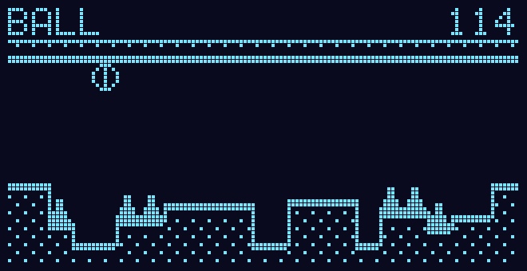
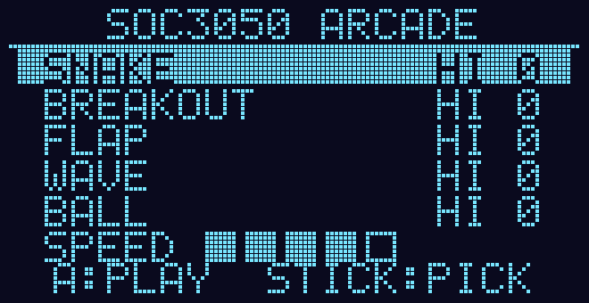

# BALL: a 5th game for the lesson 12 arcade (ball mode)

**On branch `ball-game`.** This builds on top of WAVE (`../wave-game/`).
`ball.patch` holds both games, so one apply gives you all five.



**How it plays.** A ball rolls right along a corridor that scrolls past it.
**Tap** A (or push the stick up or down) while it is touching a surface, and
gravity **flips**: the ball falls up to the ceiling and rolls along that. Tap
again to fall back down. Tapping in mid-air does nothing, but a tap up to
4 ticks before landing is remembered. Each section of the corridor has spikes
and blocks on **one** side, so you must be rolling on the other side to get
through. Between sections there is a plain stretch, and that's your moment to
flip. Touching a spike or hitting the side of a block ends the game. The score
is distance (1 point per 8 px).



## How it works (`files/ball.c`, pure C)

- **The physics is FLAP's two lines with a sign that flips:**
  `vy += dir * GRAVITY; y += vy;` with gravity 40/256 px/tick², a 64/256
  kick on a flip, and speed capped at 3 px per tick.
- **Landing:** if the ball would sink into the surface it's falling towards,
  it is put back on top of it, `vy = 0`, and it counts as **grounded**. That
  is the only state in which a tap flips.
- **Walls:** any rock that the ball's front edge enters in rows `y-2..y+2`
  is the side of a block, and that's fatal. A 1-px bump gets rolled over.
- **Spikes** have a hitbox 2 px short of the base and the tip.
- **The corridor** is generated in sections of 48 to 112 px, each with
  hazards on one side: spikes, blocks 4–16 px tall, or blocks with spikes on
  top. The side changes 65 % of the time. When it changes, a plain flip
  stretch of `24 - 2 × SPEED` px (22 down to 14) comes first.
- **`ball_sim()`** is one tick of physics on a state struct and nothing else.
  The game calls it, and the host test's autopilot calls it on copies to
  look ahead.

## Changes vs the professor's repo (`8fc971b`)

These are everything from WAVE, plus:

| File | Change |
|---|---|
| `ball.c` | new: the game |
| `engine.h` | `game_ball`, `ball_state_t`, `ball_sim`, `ball_get`, `ball_peek` |
| `arcade.c` | `&game_ball` in the list; the menu has five rows, 8 px apart |
| `host/test_games.c` | a BALL section, and Up from SNAKE now wraps to BALL |
| `host/run.bat`, `run.sh` | compile `../ball.c` |

## Verified (2026-11-06)

- **The firmware** (vendored arm-none-eabi-gcc) builds with **zero warnings**:
  FLASH 22 936 B / 32 KB, RAM 6 880 B / 12 KB.
- **The host test** passes with **0 failures** (compiled with MSVC, as gcc
  isn't installed here). The BALL checks:
  - One tap on tick 2: the ball lands on the ceiling on tick **22**, which
    matches the prediction worked out by hand from the gravity, the kick and
    the speed cap.
  - With no input it rolls through the run-up (to tick 243) and dies at the
    first floor hazard.
  - The autopilot rolls 2 minutes at level 3 (score 884, 46 flips).
  - It is deterministic, and a different seed builds a different corridor.
  - **Every level is passable.** At each of levels 1–5 a look-ahead
    autopilot rolled for 3 minutes and **never hit a tick with no way
    through**.
- **Not watched in Wokwi or the station yet.**

## Apply and run

In a clone of `github.com/gnoejh/soc3050code`:

```
git apply --ignore-whitespace "path\to\ball.patch"
```

If that fails, copy `files/` over `projects2026_arm/12_Game/` instead.
Then:

1. Run `build.bat` in `12_Game`.
2. Start the Wokwi simulator in VS Code on `12_Game\wokwi.toml`.
3. Run `uv run tools/station/station.py`.
4. In the station window, pick **BALL** and press `a` to start. Then **tap
   `a`** (or Up/Down) to flip, and use `+` for full speed.
