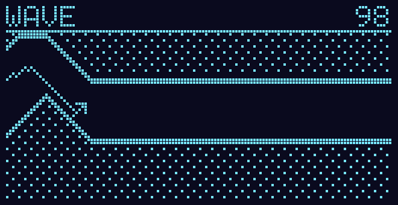
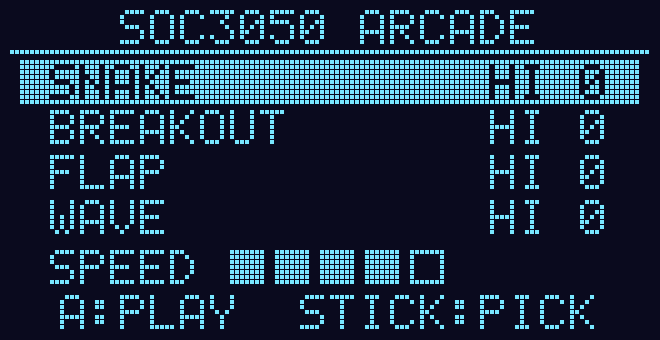

# WAVE: a 4th game for the lesson 12 arcade

This is a wave-mode game (the one where you hold to fly up) for the Embedded
Software and Design arcade in `projects2026_arm/12_Game`. It sits in the menu
under SNAKE, BREAKOUT and FLAP.



**How it plays.** A dart flies right through a cave that scrolls past it.
**Hold** A (or the Up arrow) and it climbs at 45°. **Let go** and it dives at
45°. It never flies straight, so its path is a zig-zag, and you can see that
path drawn behind it. If it touches the ceiling or the floor, the game is over.
The score is the distance flown (1 point per 8 px). The cave slowly gets
tighter and a little faster as you go.



## How it works (`files/wave.c`, pure C like the other games)

- **45° means the vertical speed equals the horizontal speed.** Each tick it
  runs `cam += pace; y += held ? -pace : +pace;` in 1/256 px fixed point.
- **The cave** is a 256-column ring buffer that stores `top[c]` and `bot[c]`
  for each world column. Columns are generated ahead of the screen in segments
  of 8 to 39 columns. In each segment the ceiling and the floor each slope by
  -1, 0 or +1 px per column, so walls are flat or at 45°, the same angles the
  dart flies. The gap never drops below `gmin`, which goes from 27 px at
  SPEED 1 to 15 at SPEED 5. It shrinks with the score but never below 12.
- **The difficulty ramp:** the pace goes up by 8/256 px per tick every 50
  points, up to at most +1/4 px per tick.
- **The hitbox** is 3 × 3 around the dart's centre (`wave_hits()`).
- **Input** uses `in->down` (held), not `in->pressed`. The other games all use
  edges, so this is the one game where holding a key matters.
- **Drawing:** the walls have 2-px edges, and the rock is filled with dots that
  stay fixed to the world, so they scroll with it. They are dots and not lines
  so they never look like the trail.

## The other changes in `wave.patch`

| File | Change |
|---|---|
| `wave.c` | new: the game |
| `engine.h` | `game_wave`, plus `wave_peek` / `wave_state` / `wave_hits` for the host test |
| `arcade.c` | `&game_wave` in the games list; the menu rows moved from 11 px to 9 px apart so four fit above SPEED |
| `host/test_games.c` | a WAVE section (below), and the "Up wraps around" checks now land on WAVE instead of FLAP |
| `host/run.bat`, `run.sh` | compile `../wave.c` too |

`build.bat` needs no change, because it compiles every `.c` in the folder.

## Verified (2026-11-06)

- **The firmware** builds with the course's vendored arm-none-eabi-gcc with
  **zero warnings**: FLASH 20 840 B / 32 KB, RAM 5 744 B / 12 KB.
- **The host test** passes with **0 failures**. It was compiled with MSVC
  (there's no gcc on my laptop), so a gcc run of `host\run.bat` is still to do.
  The WAVE checks:
  - The autopilot flies 2 minutes at level 3 without crashing (score 865).
  - With no input it hovers 3 s, then hits the floor on tick **164**, as
    predicted.
  - With A held from the start it hits the ceiling on tick **15**, as
    predicted.
  - It is deterministic, and a different seed makes a different cave.
  - **Every level is passable.** At each of levels 1–5 a look-ahead
    autopilot, using the game's own `wave_hits()`, flew for 5 minutes and
    **never hit a tick with no way through**.
- **Not watched in Wokwi or the station yet.**

## Base and how to apply

`wave.patch` was made against the professor's repo
(`github.com/gnoejh/soc3050code`) at commit `8fc971b` (2026-11-03). In a clone
of that repo:

```
git apply --ignore-whitespace "path\to\wave.patch"
```

If that fails (the professor changed those files since, or a line-ending
mismatch), copy `files/` over `projects2026_arm/12_Game/` instead. That's the
same change as whole files.

## Running it

1. `uv sync` at the repo root (once).
2. `projects2026_arm\12_Game\build.bat`
3. In VS Code with the Wokwi extension: open `12_Game\wokwi.toml` →
   F1 → **Wokwi: Start Simulator**.
4. `uv run tools/station/station.py` (or the VS Code task **ARM: Station**).
5. In the station window, click the OLED. Up/Down picks **WAVE**, `a` starts
   it, and then you **hold `a` or Up** to climb. `-` / `+` change the pace (it
   boots at 30 %, and `+` up to 100 % feels most like the real thing).
   `1`–`5` sets the level in the menu, and `p` pauses.

Hold to climb only works properly through the station, because it sends real
key-down and key-up. A plain serial terminal sends `a` as a single tap; there
the Up arrow works through auto-repeat.
