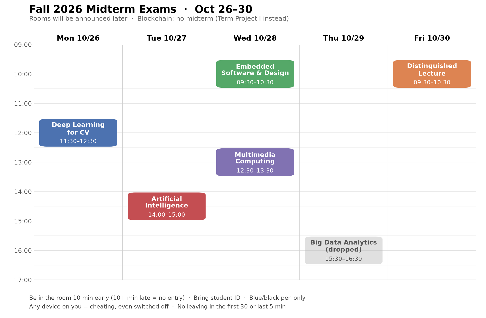

# Upcoming: deadlines, quizzes, exams

The same for everyone in ICE23-1 · last checked on eClass **Sun 2026-10-25, 21:35**.
**eClass is the authority**: check the deadline there before relying on this page. Class times and rooms
are in [timetable.md](timetable.md).

---

## 🔴 Closing soon

| Deadline | Course | Item |
|---|---|---|
| **Sun 2026-10-25 23:55** | Multimedia Computing | [Assignment 1](https://eclass.inha.ac.kr/mod/assign/view.php?id=72061) (15 pts): 6 Python scripts + requirements.txt, uploaded as **loose files**, auto-graded against reference outputs. Brief, with the doc's contradictions: [homework/assignment1](SOC4020%20-%20Multimedia%20Computing/homework/assignment1/README.md) |
| **Sun 2026-10-25 23:59** | Artificial Intelligence | **Home Assignment 1 (Kaggle, 10%)**. Upload **one ZIP holding your Kaggle notebook + the report as a PDF** to the [submission space](https://eclass.inha.ac.kr/mod/assign/view.php?id=72915) (week-8 section, opened 10-24). eClass shows 10-26 00:00; the announcement says 10-25 11:59 PM. Pick your 2 final Kaggle submissions too. Brief: [homework/hw1-kaggle](SOC4040%20-%20Artificial%20Intelligence/homework/hw1-kaggle/README.md). Word in the group chat: **the TA may ask you to explain your code** |
| **Sun 2026-10-25 23:59** | Distinguished Lecture | **Week-7 videos, both attendance-tracked**: [Video 7](https://eclass.inha.ac.kr/mod/vod/view.php?id=72441) (55:33) and [Midterm info](https://eclass.inha.ac.kr/mod/vod/view.php?id=72743) (3:19). Watch them to 100% inside the eClass player |
| **Sun 2026-10-25 23:59** | Blockchain | [Quiz 2, Week 6](https://eclass.inha.ac.kr/mod/quiz/view.php?id=72454) (2%, **1 attempt, 1 h timer from when you start**). It's week 6's attendance. **Have a calculator ready.** Practise first with the [4 week-7 games](SOC4190%20-%20Blockchain%20Basics%20and%20Platforms/README.md#week-7-mining-plus-four-practice-games) |

## 🟡 Open, later

| Deadline | Course | Item |
|---|---|---|
| **Mon 2026-11-09 23:55** | Blockchain | 🆕 [Homework 2](https://eclass.inha.ac.kr/mod/assign/view.php?id=72938) (5%, posted 10-25): one ZIP with `report.pdf` + `src/txid.py`. Sepolia transactions, reading and hand-decoding Bitcoin transactions, mining by hand. **2.6 needs mempool.space screenshots at three times of one day**, 3.5 two Etherscan looks 30 min apart. The PDF says 23:59, eClass 23:55. Brief: [homework/hw2](SOC4190%20-%20Blockchain%20Basics%20and%20Platforms/homework/hw2/README.md) |

## 📝 Midterm week (Mon 10-26 → Fri 10-30)

From the Academic Affairs timetable (Telegram, 10-22). **Rooms will be announced later.**

| When | Exam | Format and scope | Study from |
|---|---|---|---|
| **Mon 10-26 11:30–12:30** | **Deep Learning for CV** (30%) | 60 min, **33 MCQ**, no notes, no calculator. Weeks **0–6** of the Robot & AI repo | The professor's [study guide](https://github.com/gnoejh/soc4180/blob/main/weeks/exam_midterm/overview.md) (ideas, maths, traps, formula sheet, practice questions) · 🆕 [flashcard drill](SOC4180%20-%20Deep%20Learning%20for%20Computer%20Vision/my-notes/midterm-quiz/README.md), 600 cards |
| **Tue 10-27 14:00–15:00** | **Artificial Intelligence** (Mid-Exam) | **Weeks 1–6**; week 7 goes to the final (professor, 10-22). Group chat: **open questions worth ~6 points**, e.g. *k-means vs k-means++*, and decision trees for sure. **He checks your handwritten notes before the exam** | [Lecture summaries 1.1 → 6.2](SOC4040%20-%20Artificial%20Intelligence/README.md#materials-on-hand), including the new week-6 K-Means and PCA decks |
| **Wed 10-28 09:30–10:30** | **Embedded Software** (30%) | 60 min, **33 MCQ**, closed book, no calculator. Lessons **00–08** | The professor's [study guide](https://github.com/gnoejh/soc3050code/blob/main/projects2026_arm/exam_midterm/overview.md), with practice problems and answers · [course README](SOC3050%20-%20Embedded%20Software%20and%20Design/README.md) |
| **Wed 10-28 12:30–13:30** | **Multimedia Computing** | **L1–L12** (L13, image compression, started a new topic in week 7). L2 and L4 are the formula-dense ones (Huffman) | [Lecture summaries](SOC4020%20-%20Multimedia%20Computing/README.md) |
| **Fri 10-30 09:30–10:30** | **Distinguished Lecture** (30%, offline) | **30 MCQ, 1 h, 1% each**. Definitions + "which fallacy is this?" questions. **~30% ch.5 fallacies · ~60% ch.1, 6, 10, 12 · ~10% ch.2, 4, 11** | [Midterm info summary](NTS4070%20-%20Distinguished%20Lecture%20in%20Social%20Science%20and%20Art/lectures/summaries/vod/week07%20-%20Midterm%20info.md) · [flashcard drill](NTS4070%20-%20Distinguished%20Lecture%20in%20Social%20Science%20and%20Art/my-notes/midterm-quiz/README.md) |

Blockchain has **no midterm**. Term Project I (individual, 25%) is announced in week 8 instead.

### Exam-day rules

- **Bring your student ID card**, or you won't be let in. Bring your own blue or black pens.
- **Be in the room 10 min early. 10+ min late = no entry**, and no extra time. No leaving in the first 30 or
  the last 5 minutes.
- **Any device on you counts as cheating, even switched off.** Phones and smartwatches go to the locker or the
  designated area. Getting caught = F in the subject + barred from the remaining exams.
- Final answers in blue or black pen only: no correction pen, no highlighters. Write your ID and name on every page.
- **Embedded Software and Deep Learning for CV:** missing the midterm = fail. Absences must be cleared with
  Prof. Jeong Hong *beforehand*.

---

## 🗓 Later this semester

From the syllabi's weekly plans; no eClass calendar entries exist for these yet. Week 1 began **2026-09-05**,
so week *n* starts on the Saturday `09-05 + 7(n−1)`.

| Week | Dates | Milestone |
|---|---|---|
| 8 | 24 Oct–1 Nov | Blockchain **Term Project I announced** (individual, 25%, replaces the midterm) |
| 9 | 31 Oct–6 Nov | Multimedia Computing **Homework** (lossy compression / JPEG) |
| 10 | 7–13 Nov | Multimedia Computing **Homework** (video compression) |
| 12 | 21–27 Nov | Multimedia Computing **Homework** (features / invariance) |
| 12–14 | 21 Nov–11 Dec | Distinguished Lecture **Debates, offline, on Saturdays** (30% of the grade) |
| 14 | 5–11 Dec | Embedded Software **Project presentation** |
| 14 | 5–11 Dec | Artificial Intelligence **Term project presentation** (20%), possibly moved to week 16 |
| 15 | 12–18 Dec | Embedded Software **Final** (weeks 8–13) · Deep Learning for CV **Final** · Artificial Intelligence **Final** |
| 15 | 12–18 Dec | Distinguished Lecture: final week, **no exam** |
| 16 | 19–25 Dec | Multimedia Computing **Final Exam** · Embedded Software / Deep Learning for CV makeup |
| 16 | 21–25 Dec | Blockchain **Term Project II due** (team, 25%). There is no final exam |

Final exam dates aren't out yet.

---

## Rules that can cost you the course

- **Distinguished Lecture**: attendance = watching each week's VODs **inside their window** (about 9 days, and
  it closes silently). **The 4th missed VOD is an automatic F.** A quiz you *start* isn't submitted until you
  press **Submit all and finish**. One attempt only.
- **Blockchain**: attendance = **submitting the weekly quiz**. Missing more than 25% of weeks is an **F**. LMS
  deadlines are hard. You get **two 48-hour late passes**, requested from the TA **24 h or more in advance**.
- **Artificial Intelligence**: **medical certificates are not accepted**; 8+ absences is an automatic F. He
  checks your written notes before each exam. Set your Discord per-server nickname to *Full name, Student ID*.
- **Embedded Software / Deep Learning for CV**: 8 absences fails the course, and absences must be cleared with
  Prof. Jeong Hong *beforehand*, not through AA. The Embedded classroom door closes **5 minutes** after the start.
- **Multimedia Computing**: the week-1 deck says late homework is **never** accepted. Assignment 1's doc instead
  allows up to 24 h late at −30% / −50% / −70%. Don't count on either.

## The eClass calendar vs the timetable

The eClass upcoming-events feed lists **Artificial Intelligence sessions on Wednesdays**. Neither the syllabus
nor the official EduPage timetable has AI on a Wednesday: both put it on **Mon + Thu**. It's most likely an
eClass data quirk. The timetable is the reliable source for *where to be*; eClass is the reliable source for
VOD and quiz windows.
